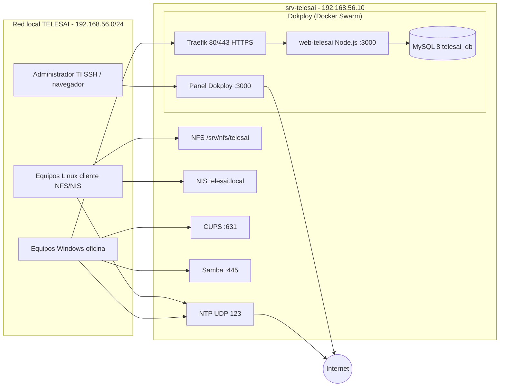

# Análisis de necesidades y diseño de infraestructura – TELESAI

**Curso:** Administración de Infraestructura de TI – Universidad del Quindío
**Estudiante:** Juan Manuel Montoya
**Fecha:** noviembre de 2026

## 1. La empresa

**TELESAI Y CÍA S.A.S.** es una empresa de Armenia, Quindío (Carrera 14A No. 10A N-01) que presta servicios de aseo, desinfección y mantenimiento de edificaciones. Atiende clientes de los sectores comercial, corporativo, industrial, hospitalario y residencial. Entre sus servicios están el aseo hospitalario, el mantenimiento locativo, el aseo post-obra, el sellado de pisos, la jardinería, la cafetería y el mantenimiento de piscinas. Según su portafolio, la empresa está certificada en la norma **ISO 9001:2015**.

> Proyecto académico: la información de la empresa se tomó de su portafolio público. El sitio web que se implementa es un sitio de referencia, no el oficial.

### Situación y necesidades

La operación de TELESAI depende de mucha información y de mucha coordinación:

- **Un sistema de calidad ISO 9001** que exige controlar documentos (procedimientos, formatos, manuales) y conservar registros con trazabilidad: quién hizo qué y cuándo.
- **Personal operativo distribuido** en las instalaciones de los clientes. La oficina programa turnos, genera órdenes de servicio y recibe solicitudes de cotización.
- **Áreas administrativas** (calidad, operaciones, talento humano, gerencia) que comparten archivos y necesitan permisos distintos.
- **Un sitio web** para presentar los servicios y recibir solicitudes de clientes.
- **Impresión** de órdenes de servicio, actas de entrega y planillas.

El director pidió centralizar en un servidor local los servicios web, los archivos, la impresión, la hora, la autenticación y el acceso compartido.

## 2. Servicios propuestos y justificación

| # | Servicio | Necesidad que resuelve en TELESAI |
|---|---|---|
| 1 | **Web (Dokploy + Traefik)** | Sitio institucional con los servicios y la política de calidad, y un formulario de cotización. Dokploy permite desplegar desde Git, publicar con HTTPS y actualizar sin entrar al servidor. |
| 2 | **Base de datos MySQL (Dokploy)** | Guarda el catálogo de servicios del sitio y las solicitudes de cotización, para que el área comercial les haga seguimiento (registro exigido por ISO 9001). |
| 3 | **NTP** | Todos los equipos tienen la misma hora. Sin esto, las fechas de los registros de calidad, los turnos y los logs no son confiables, y se pierde la trazabilidad. |
| 4 | **NFS** | Carpetas compartidas para los equipos Linux de la oficina: procedimientos de calidad, programación de turnos y carpetas personales de los usuarios. |
| 5 | **NIS** | Un solo usuario y contraseña por empleado, administrado en el servidor. Al rotar o retirar personal se cambia en un solo lugar, y los permisos por grupo (`telesai`) son los mismos en todos los equipos. |
| 6 | **CUPS** | Impresora de la oficina compartida en red, con cola administrada. Se usa una impresora virtual PDF que deja una copia digital de cada orden impresa. |
| 7 | **Samba** | Carpeta compartida accesible desde los equipos Windows de la oficina, con acceso solo para el grupo `sambausers`. |

### Decisiones de diseño

- **Un solo servidor virtualizado** (VirtualBox). La empresa es pequeña y un servidor bien administrado cubre la carga. La VM se puede respaldar y mover a otro hardware.
- **Linux Mint 22.3**, basado en Ubuntu 24.04 LTS. Usa los mismos paquetes y repositorios que la versión que pide la guía.
- **Dos tarjetas de red:**
  - NAT (`10.0.2.15`) para salir a internet: actualizaciones, GitHub y servidores NTP públicos.
  - Host-only con **IP fija `192.168.56.10`**, que hace las veces de la red local de la oficina.
- **Dokploy solo para las aplicaciones** (web y base de datos). Los servicios de red clásicos (NTP, NFS, NIS, CUPS, Samba) se instalan directamente en el sistema operativo, porque se integran con el kernel, los usuarios y los puertos privilegiados del servidor.
- **Dominio con `sslip.io`** (`telesai-192-168-56-10.sslip.io`): un DNS gratuito que resuelve a la IP incluida en el nombre. **HTTPS con certificado autofirmado de Traefik**, porque Let's Encrypt no puede validar una IP privada.
- **La base de datos no tiene puerto publicado.** La app la alcanza por la red interna `dokploy-network`.
- **`root_squash` en NFS** (y no `no_root_squash`), para que el root de un cliente no tenga control total sobre los archivos del servidor.
- **Mismo GID (3000, grupo `telesai`)** para NFS y NIS, de modo que los permisos coincidan en servidor y clientes.

## 3. Tabla de requisitos

Servidor: **srv-telesai – 192.168.56.10** (red local) / 10.0.2.15 (NAT).

| Servicio | IP | Puerto | Protocolo | Tipo de servicio |
|---|---|---|---|---|
| Sitio web (Traefik) | 192.168.56.10 | 80 → 443 | TCP – HTTP/HTTPS | Web institucional (contenedor en Dokploy) |
| Panel Dokploy | 192.168.56.10 | 3000 | TCP – HTTP | Administración PaaS |
| App web-telesai | interna (dokploy-network) | 3000 | TCP – HTTP | Backend Node.js/Express |
| MySQL | interna (`telesai-db-olxdco`) | 3306 | TCP – MySQL | Base de datos (no expuesta) |
| NTP | 192.168.56.10 | 123 | UDP – NTP | Sincronización de tiempo |
| NFS | 192.168.56.10 | 2049 (+111 rpcbind) | TCP/UDP – NFSv4/RPC | Archivos para clientes Linux |
| NIS | 192.168.56.10 | 111 + puertos dinámicos de ypserv | UDP/TCP – RPC | Autenticación centralizada |
| CUPS | 192.168.56.10 | 631 | TCP – IPP/HTTP | Servidor de impresión |
| Samba | 192.168.56.10 | 445, 139 (137-138 UDP) | TCP/UDP – SMB/NetBIOS | Archivos para Windows |
| SSH | 192.168.56.10 | 22 | TCP – SSH | Administración remota |

### Recursos de la máquina virtual

| Recurso | Mínimo de la guía | Asignado |
|---|---|---|
| vCPU | 2 | 4 |
| RAM | 4 GB | 8 GB |
| Disco | 40 GB | 60 GB |
| Red | Bridged / IP fija | NAT + Host-only con IP fija 192.168.56.10 |

## 4. Diagrama de arquitectura

El código fuente está en `diagrama.mmd` y la imagen en `capturas/diagrama-arquitectura.png`.

