# Documentación técnica – Infraestructura de servicios TI para TELESAI

**Curso:** Administración de Infraestructura de TI – Universidad del Quindío
**Estudiante:** Juan Manuel Montoya
**Empresa:** TELESAI Y CÍA S.A.S. (Armenia, Quindío – certificada ISO 9001:2015)
**Repositorio:** https://github.com/juanManuelMontoya/proyecto-final-telesai

El análisis de necesidades, la tabla de requisitos y el diagrama están en `analisis.md` y `diagrama.mmd`. Los scripts que se usaron están en `codigo/servicios/`, el sitio web en `codigo/web/` y el cliente Linux de prueba en `codigo/clientes/`.

## Resumen de servicios implementados

| # | Servicio | Estado | Cómo se comprobó |
|---|---|---|---|
| 1 | Web (Dokploy + Traefik) | ✅ | Sitio en `https://telesai-192-168-56-10.sslip.io` con contenido de la empresa |
| 2 | NTP (ntpsec) | ✅ | Windows consulta la hora al servidor con un desfase de 0,11 s |
| 3 | NFS | ✅ | Cliente Linux monta `/srv/nfs/telesai`, escribe con su usuario y `root_squash` bloquea al root |
| 4 | NIS | ✅ | Un usuario que no existe en el cliente se autentica con la clave del servidor |
| 5 | CUPS | ✅ | Impresora `Telesai-PDF` compartida, visible desde Windows, y trabajo impreso a PDF |
| 6 | Samba | ✅ | Windows conectado por SMB3 al recurso `\\192.168.56.10\telesai` |
| 7 | Base de datos MySQL (Dokploy) | ✅ | La app lee el catálogo de servicios y guarda las cotizaciones |

---

## 1. Servidor y red

### 1.1 Máquina virtual

| Elemento | Valor |
|---|---|
| Hipervisor | Oracle VirtualBox |
| Sistema operativo | Linux Mint 22.3 (basado en Ubuntu 24.04 LTS) |
| Recursos | 4 vCPU, 8 GB de RAM, 60 GB de disco |
| Nombre del servidor | `srv-telesai` |
| Adaptador 1 | NAT, `10.0.2.15`, salida a internet |
| Adaptador 2 | Host-only, IP fija `192.168.56.10/24`, red local de la oficina |

Se usó Host-only en lugar de bridged porque en la red de la universidad el modo bridged no siempre recibe IP. Con Host-only, el equipo Windows anfitrión hace de "equipo de oficina" y llega al servidor por una IP fija que no depende del Wi-Fi.

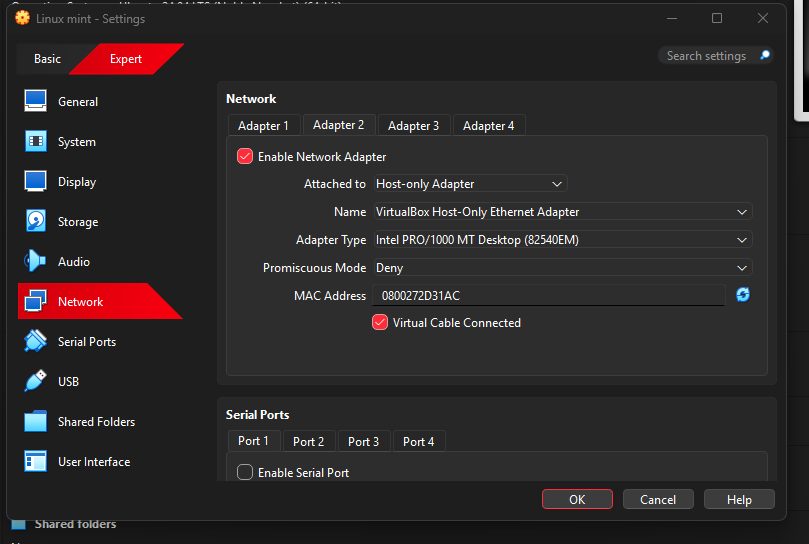

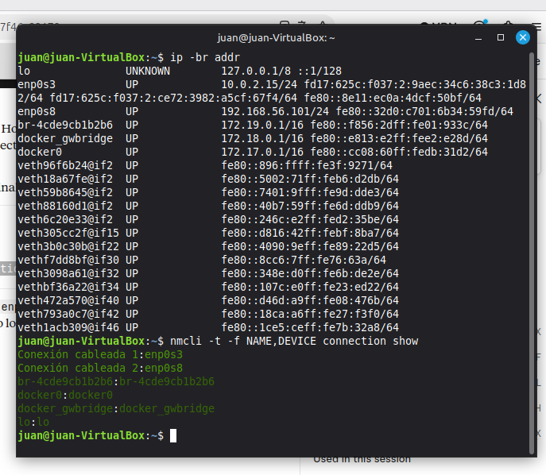

### 1.2 IP fija y nombre del servidor

```bash
sudo nmcli connection modify "Conexión cableada 2" ipv4.method manual \
  ipv4.addresses 192.168.56.10/24 ipv4.gateway "" ipv4.dns "" ipv4.never-default yes
sudo nmcli connection up "Conexión cableada 2"
sudo hostnamectl set-hostname srv-telesai
echo "192.168.56.10 srv-telesai srv-telesai.telesai.local" | sudo tee -a /etc/hosts
```

`ipv4.never-default yes` hace que la ruta por defecto siga saliendo por la tarjeta NAT, así que el servidor no pierde internet.

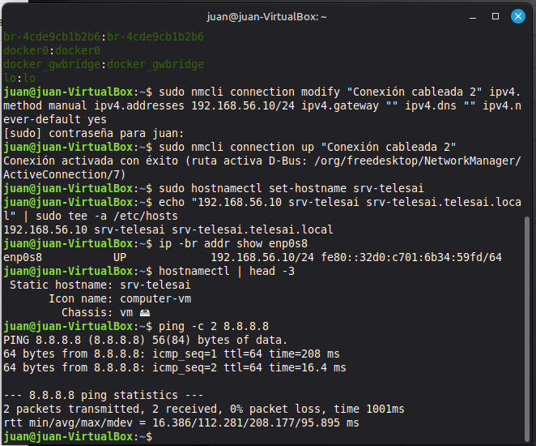

### 1.3 Administración remota

Se instaló `openssh-server` y el resto del proyecto se administró por SSH desde Windows (`ssh juan@192.168.56.10`). El panel de Dokploy se abrió desde el navegador de Windows en `http://192.168.56.10:3000`. Así la VM no tiene que mover un entorno gráfico, y se trabaja como con un servidor real.

---

## 2. NTP – Servidor de tiempo

**Instalación** (`codigo/servicios/01-ntp.sh`):

```bash
sudo apt install -y ntp ntpdate
echo "restrict 192.168.56.0 mask 255.255.255.0 nomodify notrap" | sudo tee -a /etc/ntpsec/ntp.conf
sudo systemctl enable --now ntpsec
sudo systemctl restart ntpsec
```

En Ubuntu 24.04 el paquete `ntp` instala **ntpsec**. Su archivo de configuración es `/etc/ntpsec/ntp.conf`, no `/etc/ntp.conf` como dice la guía. Los servidores `ubuntu.pool.ntp.org` ya vienen configurados. La línea `restrict` permite que la red de la oficina consulte la hora, pero no que modifique el servicio.

**Verificación:**

```bash
ntpq -p
sudo ss -ulnp | grep :123
```

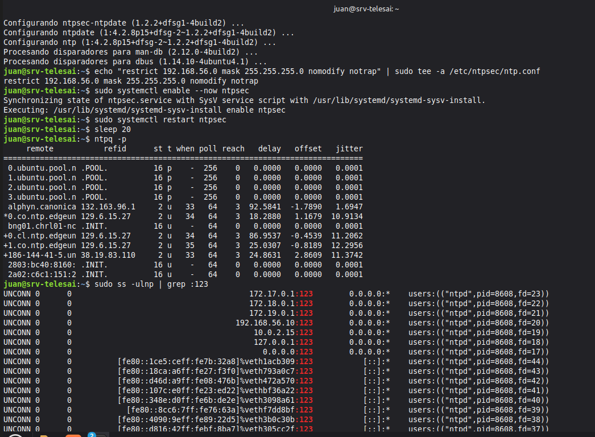

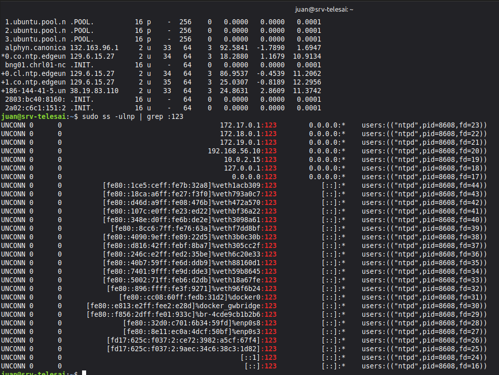

**Prueba desde un cliente (Windows):**

```powershell
w32tm /stripchart /computer:192.168.56.10 /samples:3 /dataonly
```

El primer intento dio el error `0x800705B4` (tiempo de espera agotado) porque el servicio todavía no estaba instalado. Después de instalarlo, Windows recibió la hora del servidor con un desfase de **-0,11 s**.

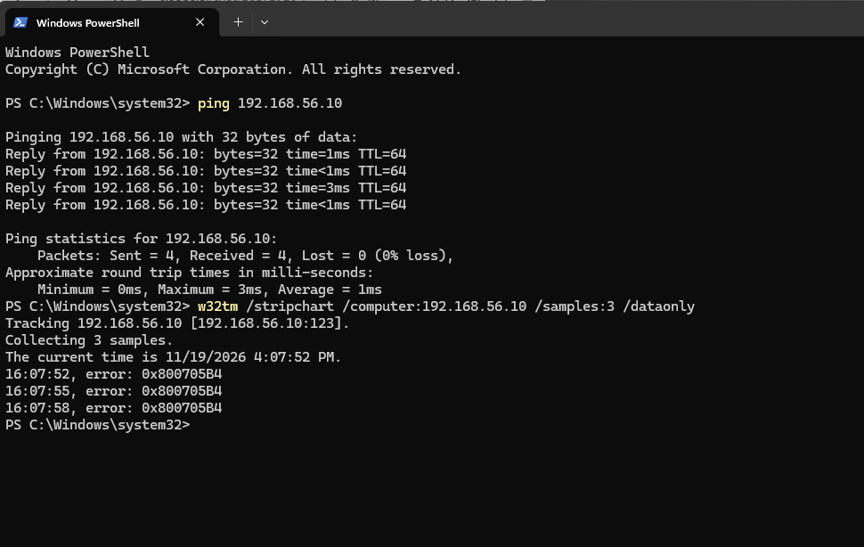

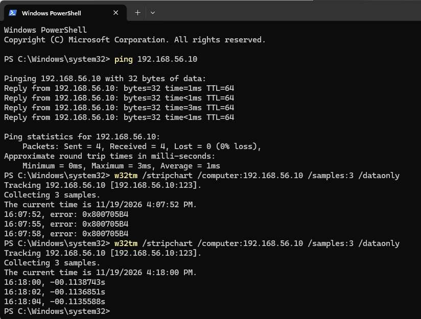

---

## 3. Dokploy, sitio web, dominio y HTTPS

### 3.1 Plataforma

Dokploy v0.30.10 ya estaba instalado en la VM, sobre Docker Swarm con Traefik v3.6.25. La instalación está documentada en la práctica anterior: Docker CE desde el repositorio de Ubuntu *noble*, porque `get.docker.com` no reconoce Linux Mint, y luego `curl -sSL https://dokploy.com/install.sh | sudo sh`.

Para liberar memoria se pusieron en 0 réplicas los servicios de la práctica anterior. Quedaron activos solo Dokploy, su PostgreSQL interno, MySQL de TELESAI y la app web.

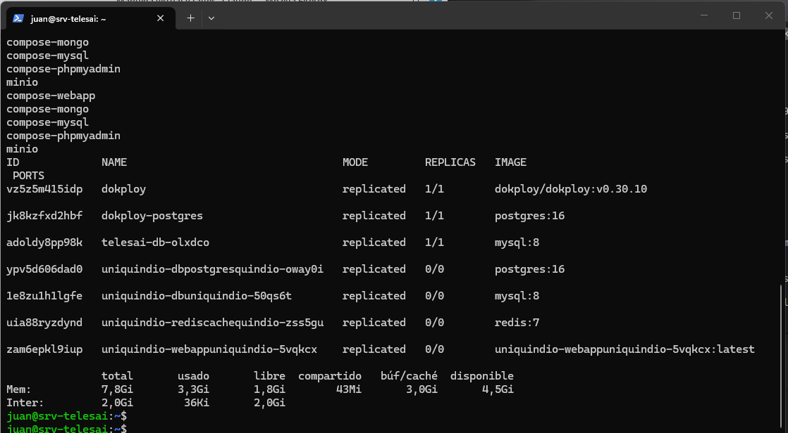

### 3.2 Repositorio Git

```bash
git init -b main && git add . && git commit -m "Proyecto final TELESAI - estructura, sitio web y scripts"
gh auth login
gh repo create proyecto-final-telesai --public --source=. --remote=origin --push
```

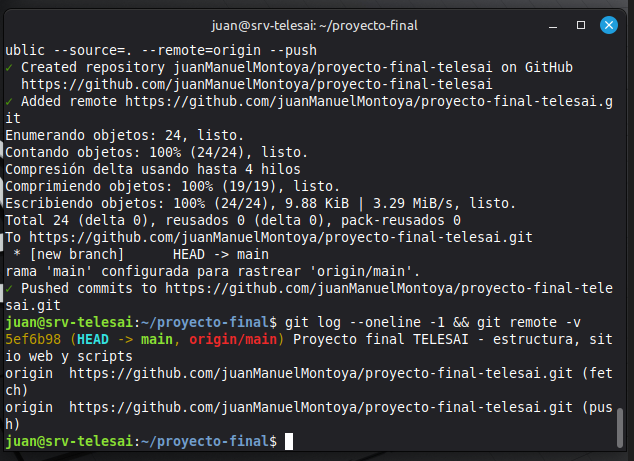

### 3.3 Base de datos MySQL (Dokploy)

En el proyecto `telesai` de Dokploy se creó un servicio MySQL 8 (*Create Service → Database → MySQL*) con el usuario `telesai_app`. Su *Internal Host* es `telesai-db-olxdco`. La base **no publica puertos**: solo se alcanza por la red interna `dokploy-network`.

### 3.4 Aplicación web

El sitio (`codigo/web/`) es una aplicación **Node.js + Express**:
- sirve la página institucional (`public/index.html`): servicios, política de calidad ISO 9001, sectores y formulario de cotización;
- expone `GET /api/servicios`, `POST /api/solicitudes` y `GET /health`;
- al arrancar, crea las tablas `servicios` y `solicitudes`, y carga los 8 servicios de la empresa.

Se construye con un **Dockerfile** (no con Nixpacks) para controlar la imagen:
- `node:20-alpine`;
- solo dependencias de producción;
- usuario sin privilegios `node`;
- `HEALTHCHECK` contra `/health`.

Configuración en Dokploy (*Create Service → Application* `web-telesai`):

| Campo | Valor |
|---|---|
| Provider | Git – `https://github.com/juanManuelMontoya/proyecto-final-telesai.git`, rama `main` |
| Build Type | Dockerfile – archivo `codigo/web/Dockerfile`, contexto `codigo/web` |
| Variables | `DB_HOST=telesai-db-olxdco`, `DB_PORT=3306`, `DB_NAME=telesai_db`, `DB_USER=telesai_app`, `DB_PASSWORD=***`, `PORT=3000` |

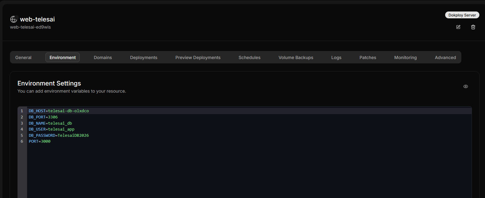

El primer build falló porque el contexto quedó en la raíz del repositorio y Docker no encontraba `package.json`. Se corrigió indicando el Dockerfile y el contexto en `codigo/web`.

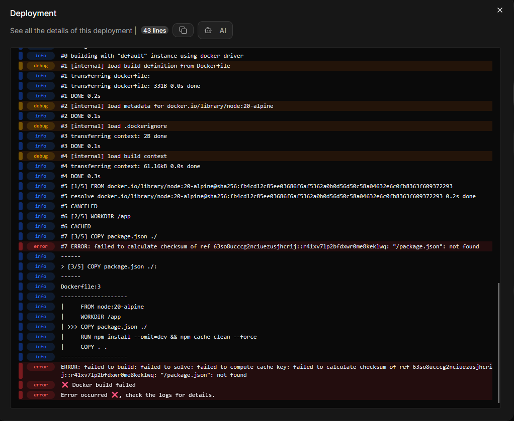

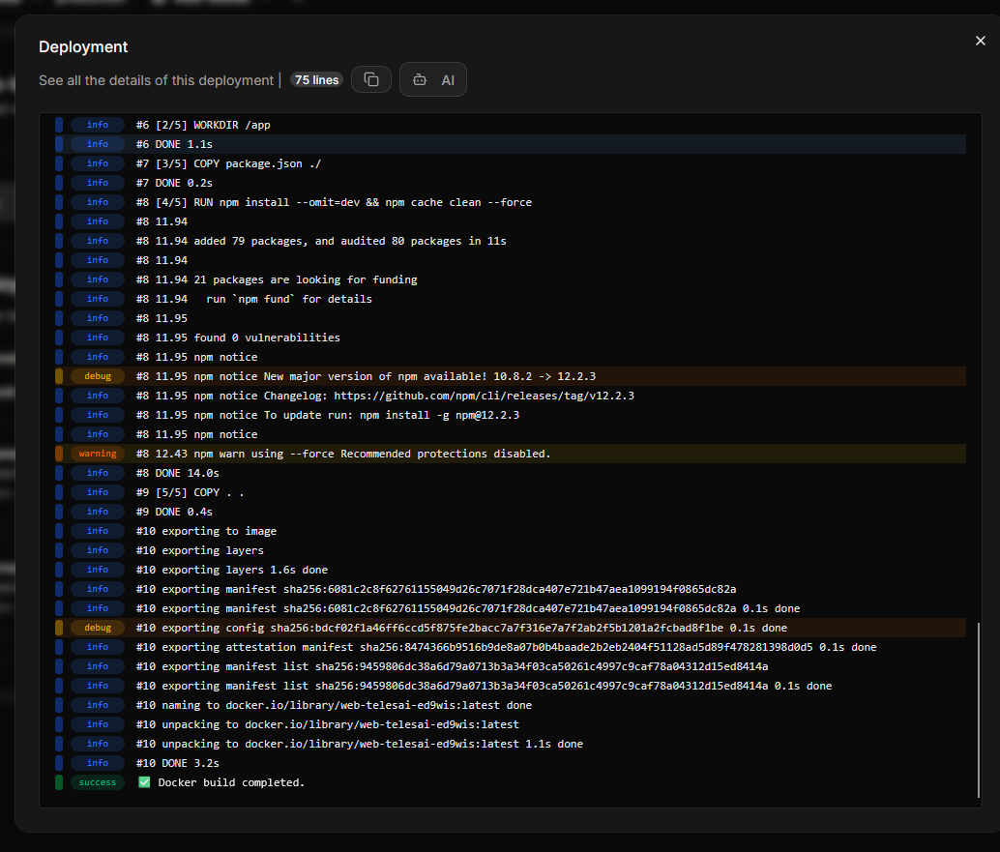

### 3.5 Dominio y SSL/TLS

| Campo | Valor |
|---|---|
| Dominio | `telesai-192-168-56-10.sslip.io` (DNS gratuito que resuelve a 192.168.56.10) |
| Puerto del contenedor | 3000 |
| HTTPS | Activado, con certificado **autofirmado** de Traefik (Certificate Provider: None) |

Let's Encrypt no puede emitir certificados para una IP privada, porque su servidor no alcanza la VM para validar el dominio. Por eso se usó el certificado autofirmado de Traefik, que la guía permite. El navegador muestra la advertencia de certificado no confiable, pero el tráfico va cifrado por HTTPS.

### 3.6 Conexión con la base de datos

El primer `/health` mostró `Access denied for user 'telesai_app'@'%' to database 'telesai_db'`. Dokploy había creado la base con el nombre `telesai-db` (con guion). Se dieron permisos sobre `telesai_db` desde el contenedor de MySQL:

```bash
DB=$(docker ps -q -f name=telesai-db-olxdco)
docker exec -i $DB mysql -uroot -p*** -e "CREATE DATABASE IF NOT EXISTS telesai_db; \
  GRANT ALL PRIVILEGES ON telesai_db.* TO 'telesai_app'@'%'; FLUSH PRIVILEGES;"
```

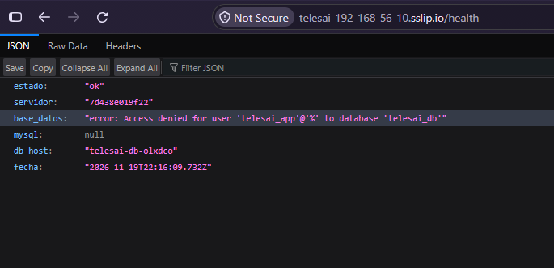

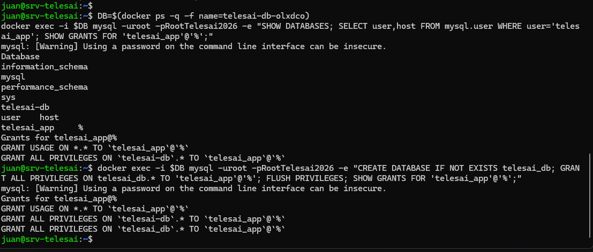

**Verificación:**

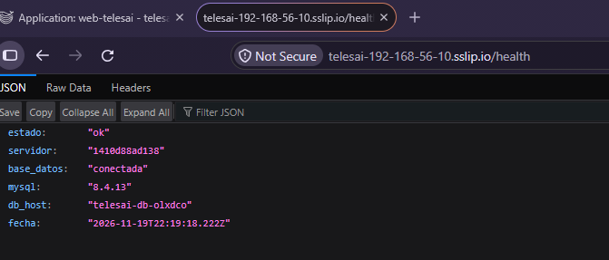

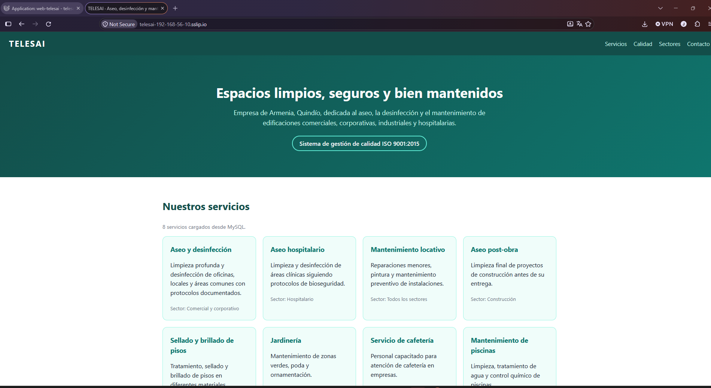

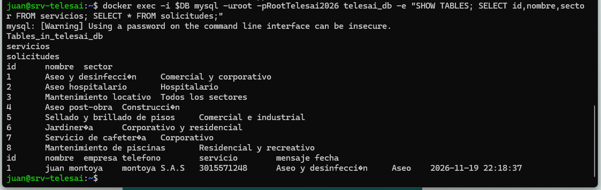

---

## 4. NFS – Archivos para clientes Linux

**Instalación** (`codigo/servicios/02-nfs.sh`):

```bash
sudo apt install -y nfs-kernel-server nfs-common
sudo groupadd -f -g 3000 telesai
sudo mkdir -p /srv/nfs/telesai/{calidad,operaciones,talento-humano,home}
sudo chown -R root:telesai /srv/nfs/telesai
sudo chmod 2775 /srv/nfs/telesai /srv/nfs/telesai/{calidad,operaciones,talento-humano}
```

`/etc/exports`:

```
/srv/nfs/telesai 192.168.56.0/24(rw,sync,no_subtree_check,root_squash)
/srv/nfs/telesai 127.0.0.1(rw,sync,no_subtree_check,root_squash)
/srv/nfs/telesai 172.16.0.0/12(rw,sync,no_subtree_check,root_squash,insecure)
```

```bash
sudo exportfs -ra
sudo systemctl enable --now nfs-kernel-server
```

Decisiones de permisos:
- **Grupo `telesai` (GID 3000) con setgid (`2775`)**: los archivos nuevos heredan el grupo, y todos los empleados del grupo pueden leerlos y modificarlos.
- **`root_squash`**, en vez del `no_root_squash` de la guía: el root de un cliente se trata como `nobody` y no puede tomar control de los archivos del servidor.
- La red `172.16.0.0/12` con `insecure` se agregó para el cliente de prueba, que corre en un contenedor Docker.

**Verificación en el servidor:**

```bash
sudo exportfs -v
showmount -e localhost
```

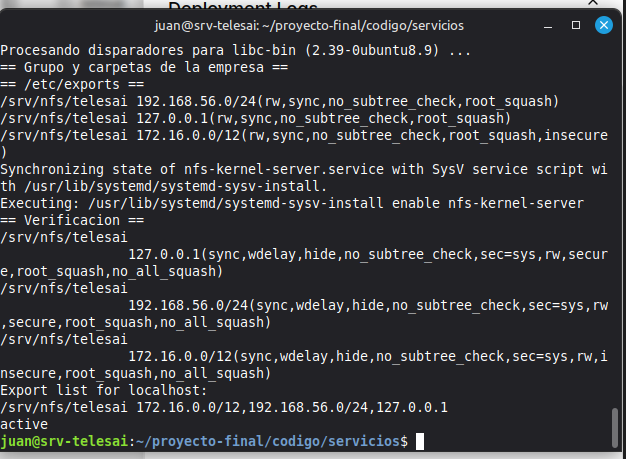

Las pruebas desde el cliente están en la sección 6.

---

## 5. NIS – Autenticación centralizada

**Instalación** (`codigo/servicios/03-nis.sh`):

```bash
echo "nis nis/domain string telesai.local" | sudo debconf-set-selections
sudo DEBIAN_FRONTEND=noninteractive apt install -y nis rpcbind
echo telesai.local | sudo tee /etc/defaultdomain
sudo sed -i 's/^NISSERVER=.*/NISSERVER=master/' /etc/default/nis
```

`/etc/ypserv.securenets` restringe quién puede consultar el servidor:

```
255.0.0.0       127.0.0.0
255.255.255.0   192.168.56.0
255.240.0.0     172.16.0.0
```

Usuarios de la empresa: grupo `telesai`, y carpeta personal en el recurso NFS.

| Usuario | UID | Cargo |
|---|---|---|
| calidad1 | 3001 | Coordinadora de Calidad |
| operaciones1 | 3002 | Supervisor de Operaciones |
| talento1 | 3003 | Analista de Talento Humano |

Inicialización del servidor maestro (en `next host to add`, Ctrl+D y Enter):

```bash
sudo /usr/lib/yp/ypinit -m
sudo systemctl restart ypserv
```

**Verificación:**

```bash
ypcat -d telesai.local -h localhost passwd | grep telesai
rpcinfo -p | grep -E "ypserv|nfs|mountd"
```

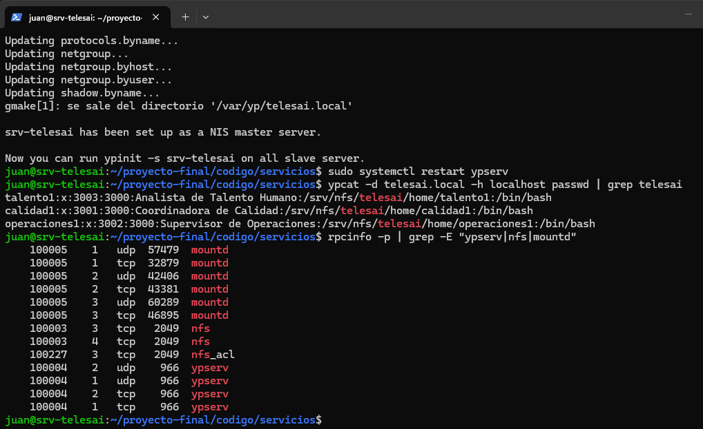

---

## 6. Cliente Linux de prueba (NIS + NFS)

Para probar los servicios desde otro equipo se construyó un cliente Ubuntu 24.04 en un contenedor (`codigo/clientes/`), que hace de "PC de oficina":
- se une al dominio NIS `telesai.local` (servidor `172.17.0.1`, que es la IP del host en la red Docker);
- configura `nsswitch.conf` con `files nis`;
- monta el recurso NFS en `/srv/nfs/telesai`.

```bash
cd codigo/clientes
docker build -t cliente-telesai .
docker run -it --rm --privileged --name pc-oficina --hostname pc-oficina cliente-telesai
```

Durante la prueba aparecieron dos problemas:
- `ypbind -no-dbus` no existe en esta versión. Se arranca simplemente con `ypbind`.
- `ypcat` funcionaba, pero `id calidad1` no encontraba al usuario. En Ubuntu 24.04, el módulo NSS de NIS viene en un paquete aparte (`libnss-nis`); se agregó al Dockerfile.

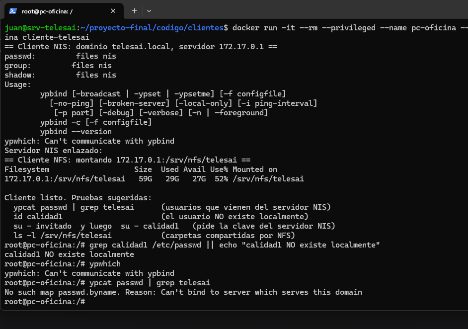

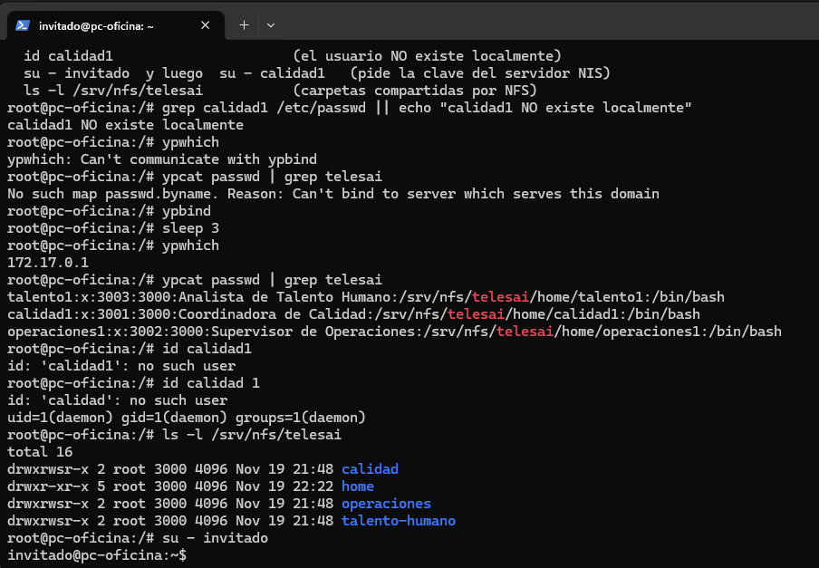

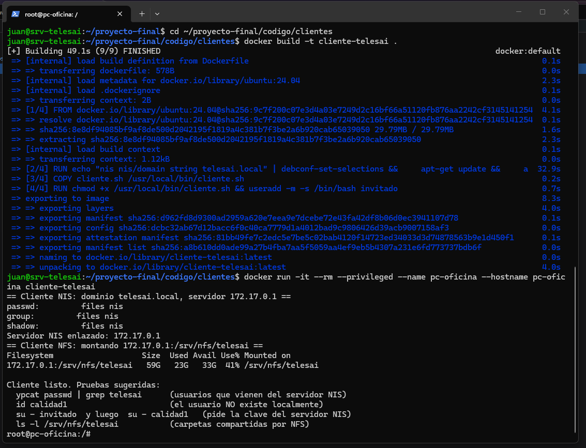

**Prueba de NIS y NFS** desde el cliente:

```bash
grep calidad1 /etc/passwd || echo "calidad1 NO existe localmente"
ypwhich ; id calidad1 ; getent passwd calidad1
su - invitado
su - calidad1            # pide la clave del servidor NIS
whoami; id; pwd
echo "Registro de auditoria interna - $(date)" > /srv/nfs/telesai/calidad/auditoria-$(date +%F).txt
ls -l /srv/nfs/telesai/calidad
```

Resultados:
- `calidad1` **no existe en el cliente**, pero `id` lo resuelve desde NIS (`uid=3001(calidad1) gid=3000(telesai)`).
- El primer `su` con la clave equivocada dio **Authentication failure**. Con la clave correcta entró, y su carpeta personal es `/srv/nfs/telesai/home/calidad1` (en NFS).
- El archivo que creó en la carpeta NFS quedó a nombre de `calidad1` y del grupo `telesai`.

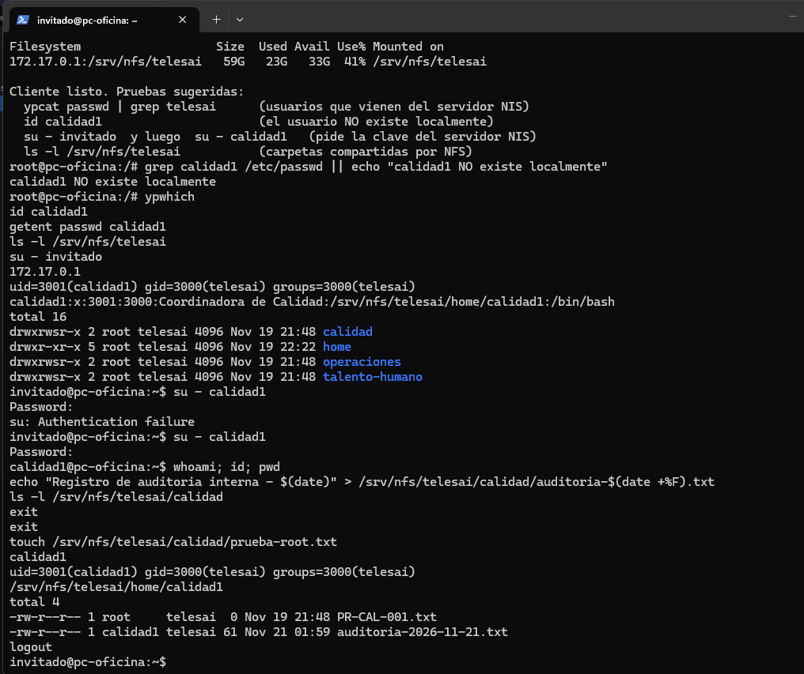

**Prueba de `root_squash`:** como root del cliente, `touch` en la carpeta compartida da `Permission denied`. En el servidor solo aparecen los archivos legítimos.

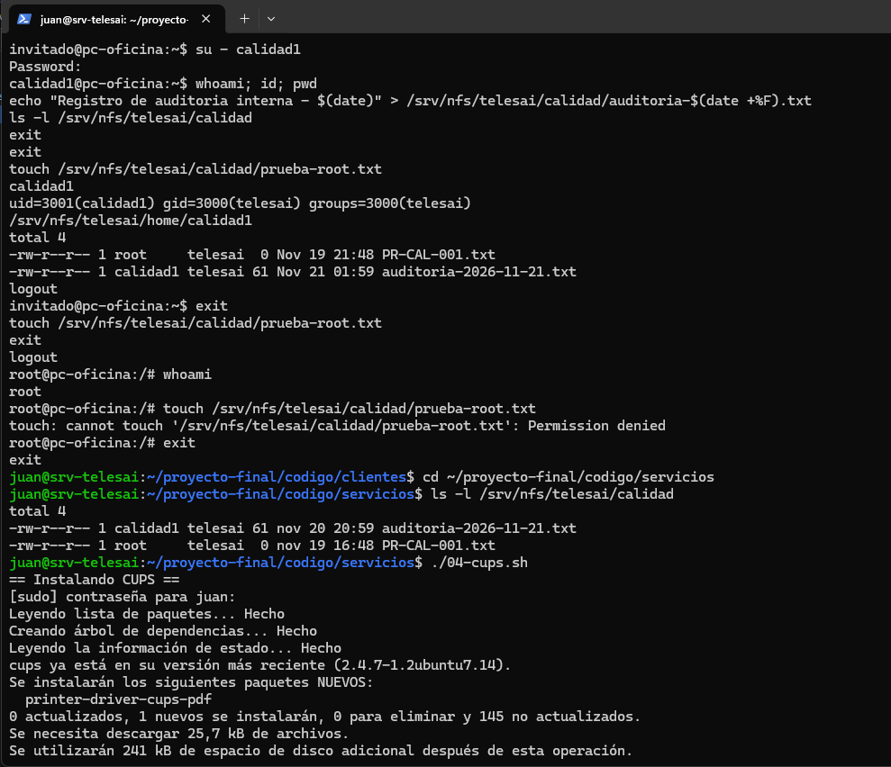

---

## 7. CUPS – Servidor de impresión

**Instalación** (`codigo/servicios/04-cups.sh`). Como no hay impresora física, se usa una impresora virtual PDF (`cups-pdf`), que además deja una copia digital de cada documento impreso:

```bash
sudo apt install -y cups printer-driver-cups-pdf
sudo usermod -aG lpadmin $USER
sudo cupsctl --remote-admin --remote-any --share-printers
sudo lpadmin -p Telesai-PDF -E -v cups-pdf:/ -P /usr/share/ppd/cups-pdf/CUPS-PDF_opt.ppd \
  -D "Impresora oficina TELESAI (PDF)" -L "Oficina principal - Armenia" -o printer-is-shared=true
sudo cupsenable Telesai-PDF && sudo cupsaccept Telesai-PDF && sudo lpadmin -d Telesai-PDF
```

`cupsctl --remote-any` hace lo mismo que cambiar `Listen localhost:631` por `Port 631` en `cupsd.conf`, como sugiere la guía, pero sin editar el archivo a mano.

**Verificación:**

```bash
lpstat -t
echo "Orden de servicio OS-0001" | lp -d Telesai-PDF -t "OS-0001"
lpstat -W completed -o
sudo ss -tlnp | grep :631
ls -l ~/PDF
```

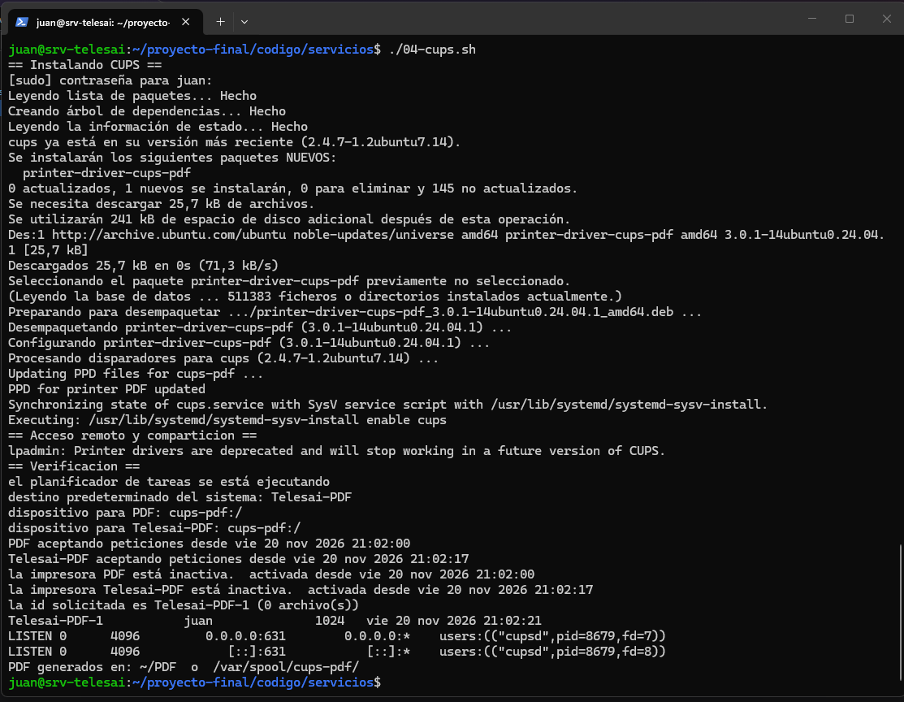

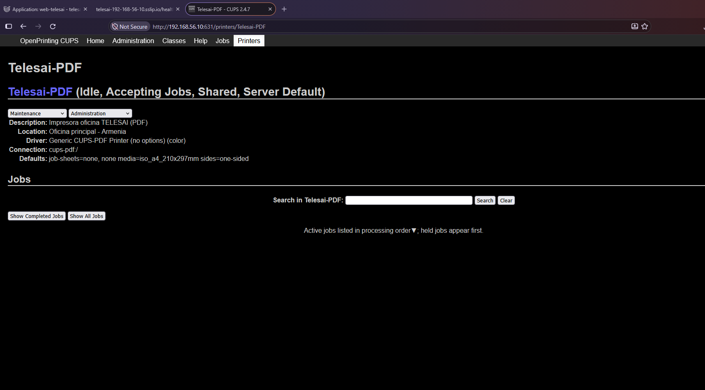

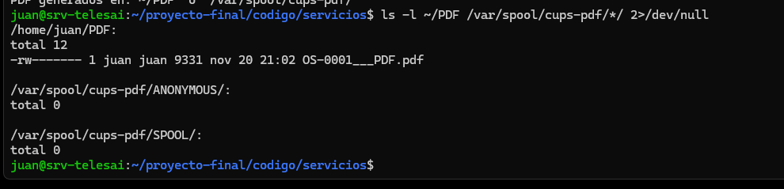

---

## 8. Samba – Archivos para Windows

**Instalación** (`codigo/servicios/05-samba.sh`):

```bash
sudo apt install -y samba smbclient
sudo groupadd -f sambausers && sudo usermod -aG sambausers $USER
sudo mkdir -p /srv/samba/telesai/{calidad,operaciones,gerencia}
sudo chown -R root:sambausers /srv/samba/telesai && sudo chmod -R 2770 /srv/samba/telesai
sudo smbpasswd -a $USER
```

Recurso agregado a `/etc/samba/smb.conf` (grupo de trabajo `TELESAI`):

```ini
[telesai]
   comment = Archivos compartidos TELESAI
   path = /srv/samba/telesai
   browseable = yes
   writable = yes
   guest ok = no
   valid users = @sambausers
   create mask = 0660
   directory mask = 2770
```

```bash
sudo systemctl enable --now smbd nmbd
smbclient -L localhost -U juan
smbclient //localhost/telesai -U juan -c 'ls; cd calidad; ls'
```

![Recurso [telesai] publicado y accesible con smbclient](capturas/29-samba-instalacion.png)

Las carpetas tienen permisos `2770`: solo el grupo `sambausers` entra, y los invitados no tienen acceso.

**Desde Windows**: `\\192.168.56.10\telesai`, usuario `juan`.

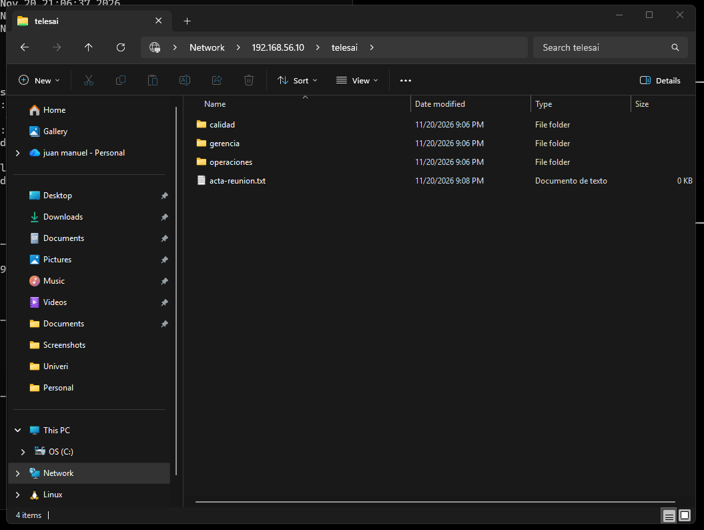

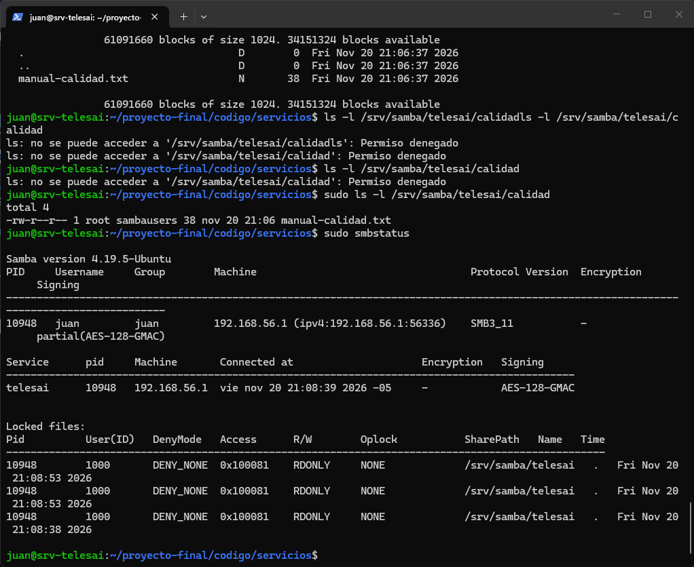

---

## 9. Recuperación tras un reinicio

Durante el proyecto el equipo anfitrión se apagó de forma inesperada. Al encender de nuevo la VM, todo arrancó solo, porque los servicios están habilitados con `systemctl enable` y los de Dokploy son servicios de Swarm:
- la IP fija;
- NTP, NFS, rpcbind y NIS;
- Dokploy, MySQL y la aplicación web;
- los exports de NFS y el dominio NIS.

```bash
systemctl is-active docker ntpsec nfs-kernel-server rpcbind ypserv
docker service ls
showmount -e localhost ; domainname
```

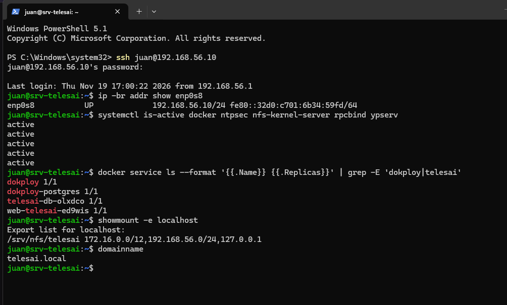

---

## 10. Problemas encontrados y soluciones

| # | Problema | Causa | Solución |
|---|---|---|---|
| 1 | La VM se congeló (79 % de CPU en VirtualBox) | Firefox con claude.ai dentro de la VM más los contenedores de la práctica anterior | Administración por SSH desde Windows y servicios viejos escalados a 0 réplicas |
| 2 | `w32tm` daba error `0x800705B4` | NTP aún no estaba instalado (timeout en UDP 123) | Instalar ntpsec y permitir la red 192.168.56.0/24 con `restrict` |
| 3 | La guía menciona `/etc/ntp.conf` | En Ubuntu 24.04 el paquete `ntp` instala ntpsec | Configuración en `/etc/ntpsec/ntp.conf` |
| 4 | `gh repo create` respondió HTTP 401 | La sesión de GitHub CLI estaba vencida | `gh auth login` |
| 5 | La pestaña GitHub de Dokploy pedía configurar una cuenta | Ese proveedor usa una GitHub App | Proveedor **Git** con la URL pública del repositorio |
| 6 | El build falló: `"/package.json": not found` | El contexto de Docker quedó en la raíz del repositorio | Dockerfile `codigo/web/Dockerfile` y contexto `codigo/web` |
| 7 | `Access denied ... to database 'telesai_db'` | Dokploy creó la base como `telesai-db` | `GRANT ALL ON telesai_db.*` al usuario de la app |
| 8 | Let's Encrypt no es posible | El dominio resuelve a una IP privada | Certificado autofirmado de Traefik (HTTPS activo) |
| 9 | `ypbind` mostraba el "Usage" | La opción `-no-dbus` no existe en ypbind-mt 2.7 | Ejecutar `ypbind` sin opciones |
| 10 | `id calidad1`: no such user, aunque `ypcat` funcionaba | Faltaba el módulo NSS de NIS (`libnss-nis`) | Instalar `libnss-nis` en el cliente |
| 11 | `ls /srv/samba/telesai/calidad`: permiso denegado | La sesión SSH no tenía activo el grupo nuevo `sambausers` | Comportamiento correcto (permisos 2770). Verificar con `sudo` o abrir una sesión nueva |
| 12 | Comandos perdidos al cerrar sesiones anidadas | Lo pegado después de `exit` lo consumía la sesión que se cerraba | Ejecutar los comandos uno por bloque |

---

## 11. Costo-beneficio

| Opción | Costo aproximado | Comentario |
|---|---|---|
| **Servidor local con esta solución** | Equipo de oficina o servidor de entrada (USD 600–1.200, una sola vez) + electricidad. Software: USD 0 (Linux, Dokploy, Samba, CUPS, NFS, NIS y NTP son libres) | Datos dentro de la empresa, sin pago mensual por usuario, funciona aunque falle internet (archivos, impresión, autenticación) |
| Microsoft 365 Business Basic + hosting web | ~USD 6 por usuario al mes + hosting (USD 5–15 al mes) | Para 10 usuarios: ~USD 70–75 al mes (~USD 850 al año). Depende de internet |
| Google Workspace Business Starter + hosting | ~USD 7 por usuario al mes + hosting | Similar al anterior |
| PaaS para la web (Heroku, Vercel) | USD 7–25 al mes solo para la app y la base | No cubre archivos, impresión ni autenticación interna |

Con unos 10 usuarios de oficina, la inversión en el servidor se recupera en uno o dos años frente a las suscripciones en la nube. A cambio, la empresa asume la administración: actualizaciones, respaldos y seguridad. Para compensar ese riesgo se recomienda:
- backups automáticos a un disco o bucket externo (Dokploy los permite programar hacia S3);
- alertas de Dokploy por ntfy o correo;
- UPS para cortes de energía (como el apagón ocurrido durante el proyecto);
- firewall UFW abriendo solo 22, 80/443, 123, 445, 631 y los puertos RPC hacia la red interna.

Los precios son aproximados, en USD, a noviembre de 2026, y sirven solo como referencia.
